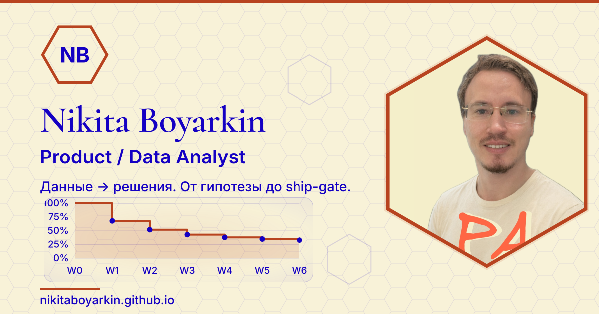

# NikitaBoyarkin.github.io

Портфолио продуктового и дата-аналитика Никиты Бояркина. Статическая
сборка на Astro, две локали (RU и EN), 22 кейса. Клиентский JavaScript —
только там, где без него не обойтись.

[](https://github.com/NikitaBoyarkin/NikitaBoyarkin.github.io/actions/workflows/deploy.yml)

**Живой сайт:** https://nikitaboyarkin.github.io/ ·
**Английская версия:** https://nikitaboyarkin.github.io/en/



> 22 кейса и двуязычное портфолио на Astro. Флагманский кейс Volta нашёл
> узкое место в онбординге и закрыл его: конверсия в KYC выросла на
> 5.72 процентного пункта.

## Навигация

- 🌐 [Сайт портфолио](https://nikitaboyarkin.github.io)
- 🏦 [Флагман: необанк Volta](https://github.com/NikitaBoyarkin/volta-banking)
- 🧪 Рядом: [A/B Testing Toolkit](https://github.com/NikitaBoyarkin/ab_test) ·
  [Causal / Uplift](https://github.com/NikitaBoyarkin/causal-uplift) ·
  [SQL Analytics Case Study](https://github.com/NikitaBoyarkin/sql-analytics-case-study) ·
  [Churn Prediction](https://github.com/NikitaBoyarkin/churn-prediction)

**На этой странице:** [Ситуация](#ситуация) · [Задача](#задача) ·
[Действия](#действия) · [Результат](#результат) ·
[Что на сайте](#что-на-сайте) · [Проекты](#проекты) · [Стек](#стек) ·
[Быстрый старт](#быстрый-старт) · [Структура проекта](#структура-проекта) ·
[Лицензия](#лицензия)

## Ситуация

Портфолио должно доказывать аналитическую работу, а не пересказывать её.
У аналитика накапливались кейсы, но не было одной точки входа, где каждый
метод связан с результатом.

## Задача

Собрать статический двуязычный сайт (RU и EN), где:

- каждый кейс доступен по своему адресу;
- каждый заголовочный показатель заморожен и проверяется машиной;
- страница проекта идёт в обязательном порядке STAR: `Ситуация → Задача →
  Действия → Результат → Ограничения → Документация`
  (EN: `Situation → Task → Actions → Result → Limitations → Documentation`).

## Действия

Сайт собран на Astro 7 и TypeScript. Вся нетривиальная логика лежит в
`src/lib/` и покрыта юнит-тестами. В репозитории 22 кейса в четырёх
`track`, 23 связанные части кейса Volta и 24 заметки.

Заголовочные числа живут в `src/lib/metrics.ts`, их сверяет
`check_metrics_drift`. Команда `bun run audit:content` сравнивает каждый
числовой токен с `docs/content-baseline.json`. Порядок разделов на
странице проекта проверяет `tests/lib/content-skeleton.test.ts`.

## Результат

Сайт работает по адресу https://nikitaboyarkin.github.io, у него есть
английское зеркало, самопроверяющаяся сборка (`make check` смотрит
готовый `dist/`) и пороги Lighthouse. Показатели заморожены. Флагманский
кейс Volta: +5.72 п. п. конверсии в KYC и €656K в год.

## Содержание

- [Что на сайте](#что-на-сайте)
- [Проекты](#проекты)
- [Стек](#стек)
- [Требования](#требования)
- [Быстрый старт](#быстрый-старт)
- [Проверка](#проверка)
- [Структура проекта](#структура-проекта)
- [Контент](#контент)
- [Аналитика](#аналитика)
- [OG-картинки](#og-картинки)
- [Синхронизация с GitHub](#синхронизация-с-github)
- [Мониторинг](#мониторинг)
- [CI/CD](#cicd)
- [Локальные хуки](#локальные-хуки)
- [Документация](#документация)
- [Лицензия](#лицензия)

## Что на сайте

Русский — язык по умолчанию. У каждого адреса ниже есть зеркало
`/en/…`, если не сказано обратное.

| Адрес | Что там |
|---|---|
| `/` | Главная: первый экран, заголовочные кейсы, срез карьеры, bento-сетка, избранные тексты |
| `/projects/` | Каталог: все 22 кейса доской, сгруппированы по `track` |
| `/projects/<slug>/` | Страница кейса (русский оригинал и английское зеркало) |
| `/projects/volta/<part>/` | 23 связанные части кейса Volta |
| `/about/` | О себе и переходы к якорям `#who`, `#work`, `#now`, `#start`, `#value` |
| `/notes/` | Хаб заметок с фильтрами по категориям (поглотил `/guides/`) |
| `/writing/` | Архив статей с пагинацией |
| `/topics/`, `/topics/<tag>/` | Таксономия тем и группировка по уровню |
| `/graph/` | Граф знаний по заметкам: сообщества, force-раскладка, зум |
| `/contact/` | Контакты |
| `/404` | Только по-русски: без английского зеркала и без `hreflang` |

Генерируемые адреса: `/rss.xml`, `/sitemap-index.xml`, `/robots.txt`,
`/llms.txt`, `/.well-known/llms.txt`, `/search-index.json`, `/graph.json`,
`/graph-en.json`. Поиск работает в браузере поверх `search-index.json`,
отдельной страницы `/search/` нет.

## Проекты

**22 кейса.** У каждого есть страница `/projects/<slug>/`, колонка на
доске по `track`, публичный репозиторий или живая демка — если они есть.
Три кейса вынесены на главную — `volta`, `sql`, `cohort`: у каждого есть
публичный артефакт, до которого можно дойти.

Обозначения: **page** — страница кейса на сайте · **repo** — исходники
на GitHub · **demo** — то, что можно запустить.

### `track: experiments`

| Проект | Что показывает | Ссылки |
|---|---|---|
| **Volta Neobank** | Нашёл узкое место в онбординге и закрыл его A/B-тестом: **+5.72 п. п.** конверсии в KYC, **€656K в год**. 23 связанные части: воронка → A/B → retention → сегментация | [страница](https://nikitaboyarkin.github.io/projects/volta/) · [репозиторий](https://github.com/NikitaBoyarkin/volta-banking) · [демо](https://nikitaboyarkin.github.io/demos/volta/index.html) |
| **A/B Testing Toolkit** | 18 методических модулей, каждый откалиброван симуляцией: A/A держит ошибку первого рода на уровне α, кривые мощности показывают достижимые размеры эффекта | [страница](https://nikitaboyarkin.github.io/projects/ab/) · [репозиторий](https://github.com/NikitaBoyarkin/ab_test) |
| **Browser Mini-Games** | 10 играбельных мини-игр на голом SVG: 7 учат аналитике (A/B до p < 0.05, провалы воронки, ловля когорт, день удержания), 3 — аркады | [страница](https://nikitaboyarkin.github.io/projects/games/) · [репозиторий](https://github.com/NikitaBoyarkin/browser-mini-games) · [демо](https://nikitaboyarkin.github.io/games/) |
| **Causal / Uplift** | CUPED сократил стандартную ошибку на **26%**: та же мощность на 5.5k пользователей в плече вместо 10k. Uplift-модели восстанавливают неоднородные эффекты | [страница](https://nikitaboyarkin.github.io/projects/causal/) · [репозиторий](https://github.com/NikitaBoyarkin/causal-uplift) |

### `track: analytics`

| Проект | Что показывает | Ссылки |
|---|---|---|
| **SQL Analytics Case Study** | 26 SQL-кейсов: 25 на синтетическом датасете (~183k событий) и 1 на реальных данных UCI Online Retail II — воронка, retention, LTV, атрибуция | [страница](https://nikitaboyarkin.github.io/projects/sql/) · [репозиторий](https://github.com/NikitaBoyarkin/sql-analytics-case-study) · [демо](https://nikitaboyarkin.github.io/sql-analytics-case-study/) |
| **RFM Segmentation** | Разбил клиентскую базу банка на 6 RFM-сегментов и показал, что небольшая доля дорогих клиентов приносит основную выручку; маркетинг ушёл от массовых рассылок | [страница](https://nikitaboyarkin.github.io/projects/rfm/) · [репозиторий](https://github.com/NikitaBoyarkin/rfm-analysis-of-bank-clients) · [демо](https://nikitaboyarkin.github.io/demos/rfm/index.html) |
| **Cohort Analysis** | Треугольная матрица retention и LTV по когортам на синтетике: ARPU и LTV на когорту с поправкой на возраст наблюдения, с экспортом | [страница](https://nikitaboyarkin.github.io/projects/cohort/) · [репозиторий](https://github.com/NikitaBoyarkin/tableau_cohort_analysis) · [демо](https://nikitaboyarkin.github.io/demos/cohort/index.html) |
| **Churn Prediction** | Модель без утечек: recall@top-10% = **0.544**, lift **5.44×** при ROC-AUC 0.916 на хронологическом сплите — активности из будущего в признаках нет | [страница](https://nikitaboyarkin.github.io/projects/churn/) · [репозиторий](https://github.com/NikitaBoyarkin/churn-prediction) |
| **Python Analytics Playground** | Модульный набор на Python — загрузка, чистка, EDA, визуализация — собран в один пайплайн с покрытием pytest ≥ 80% | [страница](https://nikitaboyarkin.github.io/projects/python/) · [репозиторий](https://github.com/NikitaBoyarkin/python) |
| **Sales Calls Analytics** | Дашборд на Streamlit по 16 891 синтетической записи звонков ИИ: воронка из 4 шагов (приветствие → оффер → встреча → квалификация) и анализ потерь | [страница](https://nikitaboyarkin.github.io/projects/sales-calls/) · [репозиторий](https://github.com/NikitaBoyarkin/sales-calls-dashboard) |

### `track: product`

| Проект | Что показывает | Ссылки |
|---|---|---|
| **Supabase Product Analytics** | Аналитика полного цикла на Supabase: A/B дал **+11.1 п. п.** (p ≈ 1.7e-10, хи-квадрат), дашборд Streamlit читает живые данные через Row-Level Security | [страница](https://nikitaboyarkin.github.io/projects/supabase/) · [репозиторий](https://github.com/NikitaBoyarkin/supabase-product-analytics) |
| **TaskFlow × PostHog** | SaaS-продукт, инструментированный PostHog от начала до конца: типизированный каталог событий, сгенерированный трафик и 7 разборов — воронка, retention, пути | [страница](https://nikitaboyarkin.github.io/projects/posthog/) · [репозиторий](https://github.com/NikitaBoyarkin/posthog-saas-analytics) |
| **Streamlit Dashboard** | Продуктовый дашборд на синтетическом датасете SaaS (8 000 пользователей): воронка AARRR, retention по когортам, выручка — MRR, ARPU, churn | [страница](https://nikitaboyarkin.github.io/projects/streamlit/) · [репозиторий](https://github.com/NikitaBoyarkin/streamlit-app) |

### `track: engineering`

| Проект | Что показывает | Ссылки |
|---|---|---|
| **Reporting Automation Bot** | Телеграм-бот заменил ручную недельную отчётность кроном: 1–2 часа работы превратились в отчёт по расписанию с таблицами KPI | [страница](https://nikitaboyarkin.github.io/projects/bot/) · [демо](https://nikitaboyarkin.github.io/demos/telegram/index.html) |
| **Scrolly English Speaking** | Скроллителлинг о разговорном английском для рабочих бесед (A2–B1): повествование на MDX с визуализациями D3 | [страница](https://nikitaboyarkin.github.io/projects/scrolly/) · [репозиторий](https://github.com/NikitaBoyarkin/scrolly-english-speaking) |
| **Digital Garden** | Личный цеттелькастен, опубликованный на Quartz v4: связанные заметки, обратные ссылки и граф вместо хронологической ленты | [страница](https://nikitaboyarkin.github.io/projects/garden/) · [репозиторий](https://github.com/NikitaBoyarkin/digital_garden) |
| **This Portfolio Site** | Сайт, который вы читаете: Astro 7, TypeScript, коллекции Markdown, статическая сборка, тёмная и светлая темы, RSS, sitemap, JSON-LD, деплой на Pages | [страница](https://nikitaboyarkin.github.io/projects/site/) · [репозиторий](https://github.com/NikitaBoyarkin/NikitaBoyarkin.github.io) |

Порядок на доске задаёт `PROJECT_ORDER` в `src/lib/projects.ts`,
заголовочные кейсы — `HEADLINE_PROJECTS` там же. Каждый показатель выше
записан в Markdown-файле проекта и сверяется с `src/lib/metrics.ts`.

## Стек

| Слой | Что выбрано |
|---|---|
| Фреймворк | [Astro](https://astro.build/) 7 (`output: "static"`, без `base` — сайт пользователя отдаётся с корня домена) |
| Язык | TypeScript 5.9 (strict), компоненты Astro |
| Контент | Коллекции Markdown со схемами Zod (`src/content.config.ts`, Astro Content Layer) |
| Стили | CSS-переменные, написанные руками (`src/styles/global.css`), три темы: тёмная (по умолчанию), светлая, cyberpunk |
| Инструменты | [Bun](https://bun.sh/) — установка, скрипты, тесты (`bun:test`), лок-файл |
| Аналитика | PostHog (`posthog-js`), молчит, пока не задан ключ на сборке; опционально Plausible |
| Хостинг | GitHub Pages через GitHub Actions |
| Графики | Свои SVG-компоненты и `src/lib/chart-svg.ts`, без библиотеки графиков |

Клиентский фреймворк не грузится вовсе. Интерактив — поиск, граф, тема,
фильтры, аналитика — собран из маленьких модулей на чистом JavaScript.
`posthog-js` подключается лениво, после первого действия.

## Требования

- **Bun** — единственный пакетный менеджер (`bun.lock` и есть лок-файл).
- **Python 3** для `make check` (`scripts/check_site.py`).
- **`rsvg-convert`** (librsvg) — только чтобы перегенерировать OG-картинки.
- По желанию: `GITHUB_TOKEN` или `GH_TOKEN` для скриптов синхронизации
  с GitHub — выше лимит запросов, видны приватные репозитории.

## Быстрый старт

```bash
bun install

# Дев-сервер на http://localhost:4321
bun run dev

# Статика в dist/
bun run build

# Собрать и отдать продакшн-сборку
bun run preview
```

## Проверка

Прогоняйте этот набор после каждой правки контента или компонента.
Всё зелёное — можно коммитить.

```bash
# Сборка Astro
bun run build

# Типы Astro и тестов
bun run check

# Типы, тесты, мониторинг и проверка готового dist/
make check

# То же, но с покрытием
bun run coverage
```

`make check` запускает `bun run check` (типы Astro и TS), тесты
(`test`, затем `test:monitoring` и `test:built`) и смотрит **готовый
`dist/`**. Сборка падает, если:

- нет обязательных страниц;
- внутренняя ссылка не находит файл в `dist/`;
- картинка из HTML отсутствует;
- фото профиля тяжелее 500 KB;
- в `index.html` нет нужных ассетов;
- **показатели разъехались** — числа в `src/lib/metrics.ts` против сайта
  (`check_metrics_drift`).

Lighthouse CI работает отдельно — см. [CI/CD](#cicd).

## Структура проекта

```text
├── astro.config.mjs        # адрес, i18n, редиректы
├── src/
│   ├── content.config.ts   # схемы Zod, 11 коллекций
│   ├── content/            # Markdown и MDX всех коллекций
│   ├── layouts/            # Base.astro, Post.astro
│   ├── components/         # 61 компонент
│   ├── lib/                # чистая логика: metrics, graph…
│   ├── pages/              # 48 модулей маршрутов
│   ├── data/               # данные графиков, github-activity
│   └── styles/             # global.css, blog.css
├── scripts/                # OG, синхронизация, check_site
├── tests/lib/              # 54 набора bun:test
├── docs/                   # PRD, ADR, SPEC
├── monitoring/             # RED-стек: Prometheus, Grafana
└── public/                 # картинки, шрифты, демо
```

Вся нетривиальная логика лежит в `src/lib/`. Тесты — в `tests/lib/`, они
же фиксируют контракты контента: скелет страницы, даты, frontmatter.
Компоненты остаются презентационными.

### Ключевые модули `src/lib`

| Модуль | За что отвечает |
|---|---|
| `metrics.ts` | **Единственный источник правды** для заголовочных чисел: первый экран, срез карьеры, страница ценности |
| `projects.ts` | `PROJECT_ORDER`, загрузка и сортировка проектов |
| `topics.ts` | Таксономия `TOPICS` и группировка по уровням — питает `/topics/` |
| `posts.ts` | Загрузка постов и пагинация `PER_PAGE` |
| `graph.ts` / `graph-layout.ts` / `graph-data.ts` / `graph-tooltip.ts` / `graph-zoom.ts` / `graph-url.ts` | Граф знаний на этапе сборки: сообщества по жадной модулярности, force-раскладка, взаимодействие |
| `charts.ts` / `chart-svg.ts` | Конфиг графиков и SVG-примитивы, из которых собраны компоненты |
| `fuzzy.ts` | Расстояние Левенштейна ≤ 2 без зависимостей, для поиска (не ломается на кириллице) |
| `analytics.ts` / `beacon.ts` / `scroll-depth.ts` | Клиентская аналитика: типизированный `track()`, RED-маячок, глубина чтения |
| `brand.ts` | Токены палитры и проверка контраста по WCAG (общая с рендерером OG) |
| `path.ts` | `withBase()` — нужен каждой внутренней ссылке и пути к ассету |
| `llms-txt.ts` | Генератор `llms.txt` на этапе сборки, общий для `/llms.txt` и `/.well-known/llms.txt`, чтобы они не разъезжались |
| `qa-corpus.ts` | Двуязычный корпус вопросов и ответов для виджета «Ask me» (`AskMe.astro`) |

## Контент

Одиннадцать коллекций, схемы — в `src/content.config.ts`:

| Коллекция | Файлов | Язык |
|---|---|---|
| `projects` | 22 | RU |
| `projects-en` | 22 | EN |
| `volta-parts` | 23 | RU |
| `volta-parts-en` | 23 | EN |
| `posts` | 24 | RU |
| `posts-en` | 2 | EN |
| `glossary` | 27 | RU |
| `glossary-en` | 27 | EN |
| `library` | 2 | RU |
| `library-en` | 2 | EN |
| `about` | 2 | RU + EN |

### Как добавить проект

1. Создайте `src/content/projects/<id>.md` **и** `src/content/projects-en/<id>.md` — всегда оба файла.
1. Положите hero-SVG в `public/images/`: поле `hero` обязательное.
1. Задайте `track` (`experiments`, `analytics`, `product` или `engineering`) для канбан-доски.
1. Допишите slug в `PROJECT_ORDER` в `src/lib/projects.ts`.
1. Запустите `bun run build && make check`.
1. Запустите `bun run sync:gh:apply`, чтобы проставить `updated:` по дате последнего пуша.

### Как добавить пост

Создайте `src/content/posts/<slug>.md`. Поле `category` — одно из
`decision-log`, `framework`, `guide`, `note`; локальный хук
`portfolio-category-guard.js` не пропустит чужое значение. Английское
зеркало кладите в `posts-en/`, если пост должен быть двуязычным.

### Правила авторства

- **Скелет страницы проекта — STAR** (порядок `<h2>`): `Ситуация →
  Задача → Действия → Результат → Ограничения → Документация`.
  EN: `Situation → Task → Actions → Result → Limitations → Documentation`.
  Раздел «Действия» — самый длинный, 50–60% текста. «Задача» — одно-два
  предложения от первого лица и **без единой цифры**. У частей Volta
  добавляется `Рекомендации` / `Recommendations`, у хаба `volta` остаётся
  своё повествование D10. За порядком следит
  `tests/lib/content-skeleton.test.ts`.
- **Описания:** одно-два предложения, сначала результат и число,
  120–200 символов. Первые 72 символа должны читаться отдельно —
  `MaterialStrip` обрезает именно там. Русский и английский пишутся
  независимо: совпадает смысл, а не перевод.
- **Числа заморожены.** Переписывание ради читаемости не меняет
  показатель. `bun run audit:content` сравнивает каждый числовой токен
  в `src/content/**` с `docs/content-baseline.json` и выходит с кодом 1
  при любом расхождении. Осознанное изменение принимают командой
  `bun run audit:content:snapshot`.
- **`related:` не зависит от локали** — в обоих языках пишите
  `/projects/<slug>/` и `/posts/<slug>/`. Префикс `en/` резолвер
  добавит сам. Писать `/en/projects/...` нельзя.
- **Карта хаба Volta генерируется.** Сгруппированная карта в
  `projects/volta.md` между `<!-- volta-map:start -->` и
  `<!-- volta-map:end -->` приходит из `bun run volta:map`. Повторите
  после добавления или переименования части.
- Разовые разделы (`Architecture`, `Run`, `Testing`, …) складывайте
  внутрь «Действий» / `Actions`.

### Двуязычная маршрутизация

- Русский — локаль по умолчанию. Английские зеркала лежат в
  `src/pages/en/` и рендерят коллекции с суффиксом `-en`.
- Каждая страница `Base` передаёт `lang` и `counterpartHref`;
  `LangSwitch.astro` переключает язык и выводит
  `<link rel="alternate" hreflang>`.
- Добавляя страницу, делайте обе локали и прописывайте `counterpartHref`
  с двух сторон.
- Только по-русски, намеренно: `notes`, `404` — без зеркала и без
  hreflang.

### Редиректы

Старые адреса схлопываются в кластер якорей `/about`
(`astro.config.mjs`): `/whois/`, `/work-with-me/`, `/now/`, `/start/` →
`/about/#…` (у первых трёх есть пары `/en/`); `/guides/` → `/notes/guides/`.

## Аналитика

`src/components/Analytics.astro` выводит фрагмент PostHog. Он **молчит,
пока не заданы переменные окружения на сборке** — все они `PUBLIC_*`,
поэтому вшиваются в статический билд:

| Переменная | Зачем |
|---|---|
| `PUBLIC_POSTHOG_KEY` | Токен проекта — без него фрагмент не рендерится |
| `PUBLIC_POSTHOG_HOST` | По умолчанию `https://us.i.posthog.com` |
| `PUBLIC_PLAUSIBLE_DOMAIN` | Опционально — скрипт Plausible как дружелюбный к приватности счётчик |
| `PUBLIC_PLAUSIBLE_SRC` | Опционально — свой или self-hosted адрес скрипта Plausible |
| `PUBLIC_BEACON_ENDPOINT` | Опционально — отправляет глубину чтения и RED-маячок в стек мониторинга (`BeaconMetrics.astro`) |

Для локальной разработки скопируйте `.env.example` в `.env`. В CI те же
имена кладутся в секреты GitHub Actions.

`src/lib/analytics.ts` — единственный клиентский модуль, который говорит
с PostHog, кроме `Analytics.astro` (он владеет инициализацией).
Компоненты зовут `track()` и не трогают глобальный объект. `posthog-js`
подгружается лениво, после первого действия пользователя, поэтому
потребительские чанки не попадают на критический путь. `track()`
буферизует события — в ограниченном буфере, с отправкой при подключении —
и не теряет ранние.

Типизированные события (`AnalyticsEventMap`): `project_viewed`,
`post_read`, `lang_switched`, `theme_change`, `ask_me_used`,
`random_post_click`, `section_viewed`, `outbound_click`, `search_used`,
`search_no_results`, `read_depth`, `filter_applied`,
`projects_track_filter`. Суперсвойства: `locale`, `theme`,
`prefers_reduced_motion`, `initial_referrer_class`, `landing_path`.
Класс первого касания считается один раз на посетителя и сохраняется.

**Договорённость:** любой элемент с `data-analytics="<name>"` отправляет
событие `<name>` по клику через делегированный слушатель в
`Analytics.astro` (`featured_project`, `github_footer`, `bento_*`,
`headline_all_projects`, …). Новые кнопки должны переиспользовать этот
атрибут, а не звать `track()` на тот же клик — иначе клик посчитается
дважды.

## OG-картинки

```bash
# OG-карточки постов: 24 PNG и webp
bun run og

# Баннер главной
bun run og:home

# Превью графа знаний
bun run og:graph

# Перегенерация при изменении
bun run og:watch
```

Рендер идёт через `rsvg-convert` со шрифтами из `scripts/og-fonts/`.
`scripts/lib/og-render.mjs` выставляет **и** `FONTCONFIG_FILE`, **и**
`PANGOCAIRO_BACKEND=fc`: macOS по умолчанию берёт бэкенд CoreText,
который игнорирует fontconfig и молча рисует не тем шрифтом. Каждый
баннер проходит проверку контраста по WCAG AA до записи на диск.
Палитра живёт в `src/lib/brand.ts` и общая с `global.css`.
`scripts/audit-palette-coverage.mjs` показывает, где используются токены
палитры; npm-скрипта у него нет — запускайте напрямую через `bun`.

## Синхронизация с GitHub

`scripts/sync-github-projects.mjs` держит `updated:` и `private:` во
frontmatter в согласии с GitHub API для каждого репозитория из `github:`
(русский файл и английский двойник). Поле `date:` он не трогает — это
дата публикации, её пишет автор.

```bash
# Только проверка: расхождения, код 1 на жёстком дрейфе
# (запускается в CI)
bun run sync:gh

# Записать updated: и private: во frontmatter
bun run sync:gh:apply

# Показать, что изменится
bun run sync:gh --dry-run

# Публичные репозитории, которых ещё нет в портфолио
bun run sync:gh:candidates
```

`scripts/sync-github-activity.mjs` пишет `src/data/github-activity.json`
— вклад, серии дней, пять карточек для графиков на `/about`. Авторизация
через `GITHUB_TOKEN`, `GH_TOKEN` или `STREAK_PAT`. Оба скрипта ходят по
расписанию — см. [CI/CD](#cicd).

## Мониторинг

В `monitoring/` лежит самостоятельный стек RED (Rate / Errors /
Duration): экспортёр на Bun с выдачей метрик в формате Prometheus и
встроенной SQLite, Prometheus, Grafana и туннель Cloudflare. Запускается
локально через Docker. Подробности — в
[`monitoring/README.md`](monitoring/README.md); нужен **личный** ключ
PostHog API, а не публичный токен проекта.

## CI/CD

Шесть workflow в `.github/workflows/`:

| Workflow | Когда запускается | Что делает |
|---|---|---|
| `deploy.yml` | пуш или PR в `master` и `main`, вручную | установка → **гейт расхождений с GitHub** (`sync:gh`, выход с кодом 1) → проверки реестра и ключей игр → материализация доски Volta → `make check` (тесты, `test:monitoring`, `test:built`, `check_site.py`) → сборка → выкладка `dist/` на Pages |
| `lighthouse.yml` | после успешного `deploy.yml` по пушу | берёт артефакт Pages, гоняет Lighthouse CI, пересобирает и проверяет доску веб-метрик, выгружает отчёты — публикацию не гейтит никогда |
| `ci-failure-notify.yml` | после падения `deploy.yml` или `lighthouse.yml` на `master` | открывает задачу на упавший прогон или комментирует уже открытую |
| `sync-github.yml` | раз в неделю (пн, 03:17 UTC), вручную | запускает `sync:gh:apply` и открывает PR с изменениями |
| `github-activity.yml` | ежедневно (04:51 UTC), вручную, по пушу в свой скрипт или workflow | обновляет `github-activity.json`; коммитит, только если данные изменились |
| `sync-contacts.yml` | ежедневно (04:23 UTC), вручную, по пушу в свой скрипт или workflow | дописывает заявки из формы Supabase в приватный журнал `portfolio-contact-backend`; пропускается, пока не задан `SUPABASE_URL` |

В пулреквестах работают все гейты, кроме выкладки. Lighthouse идёт
отдельным workflow после успешного деплоя, без переменных аналитики,
поэтому оценки остаются чистыми.

Пороги Lighthouse (`.lighthouserc.json`, 18 адресов): accessibility,
best-practices и SEO — **ошибки** при ≥ 0.95, performance —
**предупреждение** при ≥ 0.85.

Не пушьте в `master`, пока в `Settings → Pages → Build and deployment`
не выбрано `GitHub Actions`.

## Локальные хуки

`.claude/hooks/` — `contrast-gate.js` (гейт контраста для
сгенерированного вывода) и `portfolio-category-guard.js` (не даёт
посту получить `category` вне таксономии).

`bun run verify:writing-filter` — регрессионная проверка фильтра на
`/writing/` через Playwright. Работает против **запущенной сборки**
(сначала `bun run serve-dist`, либо укажите свой `BASE_URL` где угодно)
и сторожит баг каскада CSS из `src/styles/blog.css`: авторское
`display` перебивало пользовательское правило `[hidden] { display: none }`,
и список оставался видимым после клика по фильтру.

## Документация

| Путь | Что внутри |
|---|---|
| `CLAUDE.md` | Полное руководство по репозиторию — схемы, конвенции, справочник команд |
| `CONTEXT.md` | Глоссарий предметной области конверсионной поверхности (RU) |
| `docs/prd-v9.md` | Актуальный PRD (RU) — заменяет `prd-v8.md` |
| `docs/cta-inventory.md` | Каждая кнопка, её событие и адрес |
| `docs/analytics-events.md` | Каталог событий с нагрузкой |
| `docs/analytics-review.md` | Недельный пятнадцатиминутный ритуал аналитики и бенчмарк воронки |
| `portfolio-contact-backend/docs/contact-log.md` | Журнал воронки найма — приватный репозиторий, синхронизируется `sync-contacts.yml` |
| `docs/backlog.md` | Открытые задачи |
| `docs/adr/` | Записи об архитектурных решениях |
| `DESIGN.md` | Заметки о визуальной системе |

> Старые PRD (`prd-v2` … `prd-v8`) оставлены для истории. Если они
> расходятся с `docs/prd-v9.md` и `CLAUDE.md`, верьте второй паре.

## Лицензия

См. [`LICENSE.txt`](LICENSE.txt). Тексты и изображения профиля личные —
пожалуйста, не переиспользуйте их.
